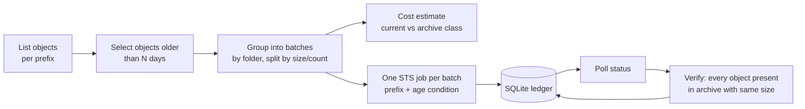

# Cloud Storage Archival Framework

[](https://github.com/ANIRUDH-VADERA/gcs-archival-framework/actions/workflows/ci.yml)


**Plan, run, track, and verify age-based archival of Google Cloud Storage data with Storage Transfer Service.**

At work I owned an initiative that archived **104 TB** of ledger data older than 13 months and cut storage and BigQuery costs by **about $45,000 a year**. This repository is a generalized version of that approach, written from scratch for open source. It contains none of the original code or configuration.

## Why this exists

Moving cold data to cheaper storage sounds like a one-line lifecycle rule, until the data is production data:

- **You need a plan first.** Leadership and data owners want to see exactly which prefixes move, how many bytes, and what it saves before anything runs.
- **Big moves fail halfway.** A single 100 TB job that fails at 80% is painful to reason about. Many small, prefix-scoped jobs are not.
- **"Old" can change.** An object might be rewritten between planning and execution. It must not be moved.
- **"Done" needs proof.** Every object that should be in the archive must be there, with the same size, before anyone deletes the source.

## How it works



| Step | What happens |
|---|---|
| **Plan** | Lists the source bucket and keeps objects last modified before the cutoff that aren't already in the target class. Groups them by folder (`batch_depth`) and splits groups that exceed `max_objects_per_batch` or `max_bytes_per_batch`. |
| **Estimate** | Compares the monthly storage cost of the selected bytes in their current classes against the target class. |
| **Submit** | Creates one one-time Storage Transfer Service job per batch, scoped with `includePrefixes`. STS checks the age again at run time through `minTimeElapsedSinceLastModification`, so nothing modified after planning is moved. |
| **Track** | Records every batch in a SQLite ledger. Re-running `run` skips batches that already succeeded or are in flight, and retries the ones that failed. |
| **Verify** | Lists the archive bucket per batch and checks every planned object exists with the same size. Batches are marked `VERIFIED` or `MISMATCH`. |

## Quick start (no GCP account needed)

```bash
git clone https://github.com/ANIRUDH-VADERA/gcs-archival-framework.git
cd gcs-archival-framework
pip install -e .
gcs-archiver demo
```

The demo runs the whole flow against an in-memory bucket that mimics a partitioned data lake (`tables/<table>/dt=YYYY-MM-DD/part-N.parquet`). One job is rigged to fail so you can see the ledger and the retry logic:

```
batch                                                  objects         size
tables/journal_lines/                                      155      80.9 GB
tables/postings/                                           138      74.5 GB
tables/reconciliation/                                     138      69.3 GB

3 jobs, 431 objects, 224.7 GB
Estimated savings: $0.63/month, $7.55/year (storage only)

Status: {'SUCCESS': 2, 'FAILED': 1}
tables/journal_lines/      transferJobs/1     VERIFIED
tables/postings/           transferJobs/2     FAILED
tables/reconciliation/     transferJobs/3     VERIFIED
```

## Using it on real buckets

```bash
pip install -e ".[gcp]"
gcloud auth application-default login

cp examples/archive.toml archive.toml                   # edit buckets and prefixes
gcs-archiver plan   --config archive.toml               # what would move and what it saves
gcs-archiver run    --config archive.toml               # dry run: prints the plan only
gcs-archiver run    --config archive.toml --execute --limit 5   # roll out in phases
gcs-archiver status --config archive.toml               # poll jobs into the ledger
gcs-archiver verify --config archive.toml               # prove every object arrived
```

Create the archive bucket with default storage class `ARCHIVE`, or enable **Autoclass** if some archived data may still be read. Keep `delete_source_after_transfer = false` until a full run has been verified.

## Design decisions

- **Prefix-scoped jobs.** A failure only affects one folder, retries are cheap, and progress is easy to report.
- **The age rule is checked twice.** Once in the planner, and again by STS when the job runs.
- **The ledger is the source of truth.** Re-running is safe: completed work is skipped and failed work is retried. It also gives you an audit trail for sign-off.
- **Verify before delete.** Deleting source objects is opt-in and should only follow a verified run.
- **Cloud code is behind interfaces.** `StorageBackend` and `TransferClient` have in-memory implementations, so the planner, ledger and verifier are fully tested without a GCP account.

## Project layout

```
src/gcs_archiver/
  planner.py    eligibility, batching, size/count splitting
  cost.py       storage cost estimate and savings
  transfer.py   STS job spec builder + client
  ledger.py     SQLite ledger (resumable, auditable)
  runner.py     plan -> submit -> refresh -> verify
  storage.py    GCS backend + in-memory backend
  fakes.py      fake STS client and sample data for the demo
  cli.py        command-line interface
tests/          unit and end-to-end tests (no cloud needed)
```

## Tests

```bash
python -m pytest        # or: PYTHONPATH=src python -m unittest discover -s tests
```

## Limitations

- The cost estimate covers storage only. Archive-class retrieval and early-deletion fees matter if archived data is read often.
- Verification compares names and sizes, not checksums. STS already validates checksums during the transfer.
- BigQuery external tables over moved prefixes need their URIs updated.

## License

MIT
